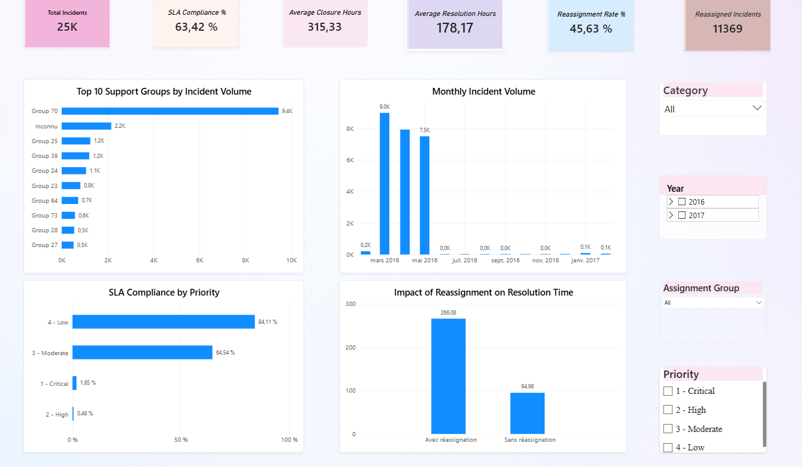

# IT Incident Management Analytics — analyse de départ

[← Retour à la présentation des trois travaux](../README.md)

Cette analyse transforme un journal d'incidents ITSM en indicateurs, en recommandations et en tableau de bord Power BI. Elle aide les responsables IT à suivre le respect des SLA, à repérer les groupes surchargés et à prioriser les améliorations.

## Résultats clés

| Indicateur | Résultat | Lecture métier |
| --- | ---: | --- |
| Incidents analysés | 24 918 | Base assez large pour suivre la performance du support |
| Conformité SLA globale | 63,42 % | Niveau perfectible |
| Temps moyen de résolution | 178,17 h | Délais élevés, à suivre par priorité et par groupe |
| SLA — priorités Critical / High | 1,85 % / 0,49 % | Les incidents les plus sensibles respectent le moins les délais |
| Résolution selon réassignation | 266 h contre 95 h | Les incidents réassignés prennent nettement plus de temps |

## Tableau de bord Power BI



## Recommandations

1. Renforcer le suivi des incidents Critical et High.
2. Améliorer la qualification et le routage pour limiter les réassignations.
3. Suivre ensemble le volume, le SLA et le temps de résolution de chaque groupe.
4. Contrôler les incidents sans groupe ou associés au groupe `Inconnu`.
5. Mettre en place des alertes avant le dépassement d'un SLA.

## Notebooks

1. [Compréhension des données](01_Data_Understanding.ipynb)
2. [Nettoyage et préparation de la table d'incidents](02_Data_Cleaning.ipynb)
3. [Analyse exploratoire et KPI](03_Exploratory_Data_Analysis.ipynb)
4. [Contrôle des KPI en SQL](04_SQL_Analysis.ipynb)
5. [Enseignements métier et recommandations](05_Business_Insights.ipynb)

Pour aller plus loin : [définition des KPI](../docs/KPI_Definition.md), [dictionnaire des données](../docs/Data_Dictionary.md) et [source des données](../docs/Dataset_Source.md).

## Lancer les notebooks

Depuis la racine du dépôt :

```powershell
python -m venv .venv
.\.venv\Scripts\Activate.ps1
pip install -r requirements.txt
jupyter notebook
```

## Stack

Python · pandas · NumPy · SQL (SQLite) · Matplotlib · Jupyter Notebook · Power BI · DAX
