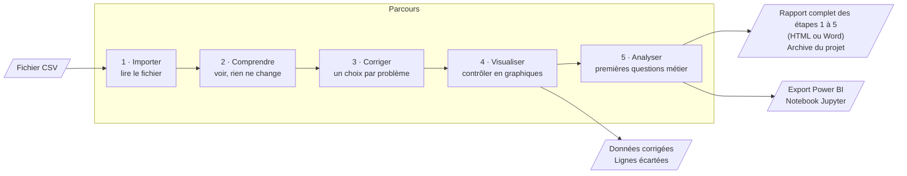
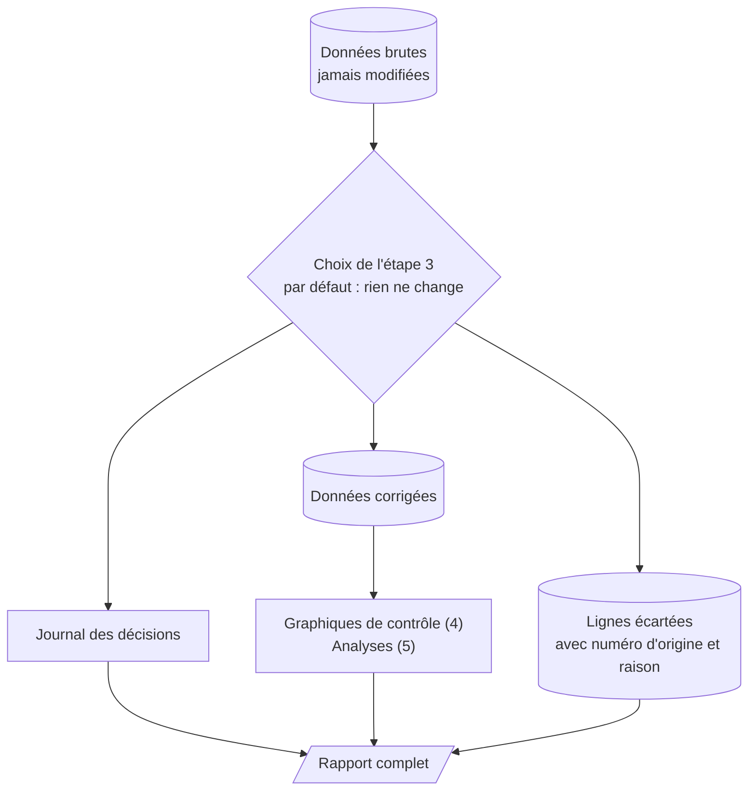
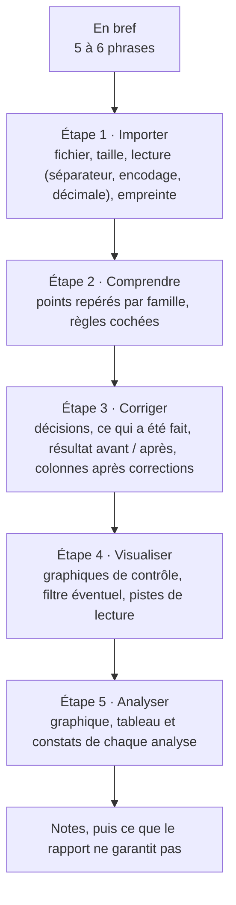

# Analyse simple — audit qualité d'un CSV avant l'analyse métier

**Analyse simple** est une application web pour analyste débutant ou en apprentissage. Elle prend
n'importe quel fichier CSV et guide l'utilisateur en cinq étapes :

1. comprendre ce que contient le fichier ;
2. corriger les problèmes de forme en un clic ;
3. contrôler le résultat en graphiques ;
4. poser les premières questions métier ;
5. remettre des données fiables, avec un rapport qui trace chaque décision.

L'outil n'impose aucune colonne et ne contient aucune règle métier. Il fonctionne aussi bien sur
des incidents IT que sur des ventes, des notes d'élèves ou des relevés de capteurs. Il est
indépendant des notebooks et des fichiers Power BI du dépôt.

## Démarrer

Depuis la racine du dépôt, dans l'environnement virtuel :

```powershell
python -m pip install -r src/requirements.txt
python -m streamlit run src/app.py
```

Avec Docker Desktop, sans rien installer d'autre :

```powershell
docker compose up -d --build      # puis ouvrir http://localhost:8503
docker compose logs --tail 50 analyse
docker compose down
```

- Le port n'est ouvert que sur la machine locale. Pour en changer : `$env:ANALYSE_PORT = "8504"`
  avant `docker compose up`.
- Les données, notebooks et fichiers Power BI du dépôt ne sont pas copiés dans l'image : le CSV
  s'importe depuis l'interface.
- Après une modification du code, relancer `docker compose up -d --build`.

## Le parcours en un coup d'œil



Le fichier d'origine n'est jamais modifié. Chaque correction repart des données brutes, et tout
ce qui est décidé est noté :



## Les étapes en détail

### 1 · Importer

| Ce que vous voyez | Ce que vous décidez | Ce qui en sort |
|---|---|---|
| Nom du fichier, nombre de lignes et de colonnes, aperçu des 20 premières lignes | Rien d'obligatoire. Si le tableau semble mal découpé, les options de lecture (séparateur, encodage, décimale) sont dans « Le tableau ne ressemble pas à votre fichier ? » | Les données brutes, gardées telles quelles |

- Une seule zone de dépôt, centrée et en français (« Glissez un fichier CSV ici », « Choisir un
  fichier », taille maximale). « Essayer avec un exemple » charge un petit fichier de
  démonstration (`assets/exemple.csv`) pour découvrir l'outil sans ses propres données.
- Au-delà de 100 Mo, un conseil s'affiche : jusqu'à 30 secondes par étape, environ 4 Go de
  mémoire, un seul onglet ouvert.
- Les identifiants comme `001` sont lus en texte, pour garder leurs zéros.
- Si une seule colonne est lue, un message explique que le séparateur est sans doute faux.
- Changer une option après avoir fait des choix efface ces choix, avec un avertissement.

### 2 · Comprendre

| Ce que vous voyez | Ce que vous décidez | Ce qui en sort |
|---|---|---|
| Chiffres clés (lignes, colonnes, points à vérifier) ; une carte par colonne : type en mots simples, part remplie, valeurs différentes, mini-graphique ou minimum, médiane, moyenne, maximum ; la liste des points à vérifier | Corriger le type d'une colonne (clic sur l'étiquette « Catégorie », « Identifiant »…) ; cocher des **règles facultatives** : « doit être remplie », « valeurs uniques », « entre deux bornes » | Le type de chaque colonne, les règles cochées |

- Quand un identifiant se répète, le volet **« Pourquoi … se répète ? »** montre ce qui change
  entre les lignes d'une même valeur : part des groupes où chaque colonne change, colonnes
  toujours identiques, un exemple. Un identifiant répété n'est jamais présenté comme une erreur.
- À cette étape, rien n'est modifié.

### 3 · Corriger

Une carte par famille de problèmes. Chaque carte n'apparaît que si le fichier est concerné.

| Problème repéré | Choix possibles |
|---|---|
| Codes qui ressemblent à des valeurs manquantes (« ? », « NA », « inconnu »…) | C'est une valeur manquante · Garder tel quel |
| Texte dans une colonne de nombres | Traiter comme des nombres · Écarter ces lignes · Ne rien changer |
| Cases vides | Laisser vide · Écarter ces lignes |
| Lignes identiques | Garder toutes les lignes · Garder une seule ligne |
| Dates ambiguës (05/03 = 5 mars ou 3 mai ?) | Jour d'abord · Mois d'abord |
| Espaces en trop (« A » et « A␣ » comptés comme deux valeurs) | Laisser tel quel · Supprimer les espaces en trop |
| Règles cochées non respectées | Garder et signaler · Écarter ces lignes |

- **Par défaut, rien ne change.** L'explication de chaque carte est derrière l'icône (?), et
  « Voir les lignes concernées » montre des exemples.
- Le résultat se met à jour en direct : lignes gardées et écartées, cases vides avant → après,
  moyenne avant → après, journal.
- Une ligne écartée n'est pas effacée : elle part dans un fichier à part. L'écran le rappelle :
  « écarter n'est pas corriger ».
- « Valider et voir les graphiques » enregistre les choix, relus au moment du clic.

### 4 · Visualiser

- **Trois graphiques de contrôle**, choisis selon les types de colonnes : répartition d'une
  catégorie, comparaison ou distribution d'un nombre, évolution dans le temps. Chacun a une
  phrase « À retenir ».
- **Ajouter un graphique**, guidé par une question : comment se répartit une colonne, comment ça
  évolue, comparer des groupes.
- **Filtrage**, éteint par défaut : garder ou exclure des valeurs d'une catégorie, choisir une
  période. Il ne change que les graphiques, jamais les fichiers téléchargés. Ses réglages sont
  gardés quand on change d'étape, et le rapport (étape 5) l'indique.
- **Téléchargements** : « Données corrigées (CSV) » (lisible par Excel) et « Lignes écartées (CSV) »
  (numéro de ligne d'origine et raison). Le rapport et l'archive sont à l'étape 5.

### 5 · Analyser

Premières questions métier sur les données corrigées. **Vous choisissez les colonnes ; l'outil
calcule, classe et décrit ce que montrent les chiffres, sans jamais donner de cause.**

| Analyse | Il faut | Ce que l'outil montre |
|---|---|---|
| Comparer des groupes | une Catégorie | Classement par nombre, moyenne ou médiane d'un nombre ; poids du premier groupe, concentration, valeurs manquantes |
| Mesurer un délai | deux Dates | Délai médian global et par groupe ; plus long, plus court ; un groupe très lourd qui tire la médiane |
| Évolution dans le temps | une Date | Nombre par jour, mois ou année, pour tous ou une valeur ; périodes très chargées ou presque vides |

- Une analyse impossible faute de colonne du bon type est remplacée par un message qui dit
  pourquoi.
- Si une colonne Identifiant se répète, « Compter chaque … une seule fois (sa dernière ligne) »
  est coché par défaut : on compte alors des incidents, des commandes ou des clients, pas des
  lignes.
- Un groupe de moins de 20 éléments est signalé « trop peu pour comparer ».
- **Passerelles** :
  un seul téléchargement, **« Données + notebook (ZIP) »**. Une fois extrait (clic droit → Extraire
  tout), le dossier contient :
  - `donnees_corrigees.csv` : les données corrigées typées, avec la colonne de délai déjà calculée,
    pour Power BI, Excel ou un autre outil ;
  - `analyse.ipynb` : un notebook Jupyter, généré à partir d'un modèle, qui lit le CSV posé à côté et
    suit les étapes d'une analyse : charger, aperçu (lignes, colonnes, types), qualité (cases vides,
    doublons), statistiques (moyenne, médiane, minimum, maximum, écart-type ; valeurs fréquentes),
    graphiques (matplotlib), puis les analyses choisies ;
  - `dictionnaire_colonnes.csv` (type et format de chaque colonne) et `LISEZMOI.txt`.
  Un fichier ouvert directement dans le ZIP, sans l'extraire, n'est pas utilisable.
- **Télécharger votre travail**, en fin de parcours :

| Fichier | Contenu |
|---|---|
| Rapport complet (HTML) | Le rapport des étapes 1 à 5, à lire dans le navigateur, avec les graphiques ; imprimable en PDF |
| Rapport Word (.docx) | Le même rapport à ouvrir dans Word, graphiques et tableaux compris |
| Tout le projet (ZIP) | Tout : fichier d'origine inchangé, données corrigées, lignes écartées, rapports HTML, Word et texte (Markdown), journal détaillé, et le dossier « données + notebook » dans `donnees_et_notebook/` |
| Données + notebook (ZIP) | Le dossier décrit ci-dessus |

  Le champ « Ce que je retiens (facultatif) » ajoute vos notes au rapport.

## Le rapport complet

Un seul rapport, téléchargé à l'étape 5, qui retrace tout le parcours dans l'ordre :



- Les trois versions (HTML, Word, texte de l'archive) sont produites à partir d'une même liste de
  sections : elles disent exactement la même chose.

- Les **pistes de lecture** sont des phrases calculées, sans règle métier. Exemples : une colonne
  remplie à moins de 50 % ; une moyenne loin de la médiane (« la médiane décrit mieux une valeur
  typique ») ; une valeur qui représente plus de la moitié des lignes ; un identifiant répété
  (« comptez les valeurs distinctes plutôt que les lignes »).
- Les analyses et le filtre sont effacés à chaque nouvelle validation de l'étape 3 : le rapport
  ne décrit jamais des analyses faites sur d'anciennes données.
- Dans le HTML, tout texte issu du fichier est échappé : un nom de colonne ou une valeur
  contenant du code ne s'exécute pas à l'ouverture.

## Ce qui ne change jamais

- Le fichier d'origine n'est jamais modifié ; chaque traitement repart de lui.
- Par défaut, aucun choix ne modifie les données.
- Moyenne et médiane seulement pour les nombres ; aucune colonne ni règle propre à un domaine.
- Un constat décrit les chiffres, jamais une cause ; le mot « retard » n'est pas utilisé.
- Le rapport ne certifie pas l'exactitude des valeurs : il dit ce qui a été vérifié.
- Tout reste en mémoire : télécharger avant de fermer la page.

## Assistant IA (facultatif)

Un onglet explique le fichier, conseille des corrections et propose des analyses avec l'API GPT. L'IA n'est appelée qu'au
clic, à partir d'un résumé sans les lignes du fichier, et ne décide de rien. Sans clé, tout le reste fonctionne.
Configuration et détail de ce qui est envoyé : [ia/README.md](ia/README.md).

## Outils et stack

| Outil | Version | Rôle dans le projet | Pourquoi ce choix |
|---|---|---|---|
| Python | 3.12 | Langage de tout le projet | Standard de l'analyse de données, lisible par un analyste débutant |
| Streamlit | 1.66 (≥ 1.57) | Interface web : écrans, boutons, téléchargements | Une application web en Python, sans HTML ni JavaScript à écrire ; widgets récents (choix segmentés, volets, interrupteurs) |
| pandas | 3.0 | Lecture du CSV, calculs, corrections | La référence pour les tableaux en Python ; traitement sur les valeurs distinctes pour rester rapide |
| Altair | 6.3 (≥ 5) | Graphiques de l'écran | Graphiques déclaratifs, couleurs et étiquettes maîtrisées, intégrés à Streamlit |
| vl-convert-python | 1.9 | Graphiques des rapports, en images SVG (HTML) et PNG (Word) | Dessine les mêmes graphiques qu'à l'écran, sans navigateur ni service externe |
| python-docx | 1.2 | Rapport Word (.docx) | Crée un vrai document Word, avec titres, tableaux et images, sans Word installé |
| Docker et Docker Compose | Python 3.12 slim | Lancer l'outil sans installation | Même environnement partout, utilisateur non administrateur, contrôle de santé |
| unittest et `streamlit.testing` (AppTest) | bibliothèque standard | Tests des calculs et des écrans | Aucune dépendance de test à ajouter ; écrans testés sans navigateur |
| Playwright et Chromium | 1.64 | Test du parcours dans un vrai navigateur (développement seulement) | Vérifie les clics, téléchargements et réexécutions réels |
| Inter, thème « Sarcelle qualité » | — | Police et couleurs | Lisible et reposant ; couleurs des graphiques vérifiées (contraste, daltonisme) |

Seuls pandas, Streamlit, Altair, vl-convert-python et python-docx sont nécessaires pour faire tourner l'outil
(`src/requirements.txt`).

## Organisation du code

```
src/
  app.py                 navigation entre les 5 étapes (point d'entrée)
  config.py              constantes : seuils, couleurs, limites d'affichage
  .streamlit/config.toml thème « Sarcelle qualité »
  assets/                logo (barre du haut et rapport), fichier d'exemple de l'import
  core/                  commun : lecture, dictionnaire, types, dates, statistiques, règles,
                         textes, dessin des graphiques, session (seul module Streamlit)
  etape1_importer/       écran d'import
  etape2_comprendre/     fiches de colonnes, diagnostic, points à vérifier, répétitions + écran
  etape3_corriger/       pipeline, application des choix, résultat, journal + écran
  etape4_visualiser/     préparation, graphiques de contrôle, exports, rapport, pistes de lecture + écran
  etape5_analyser/       comparer, délai, évolution, résumés pour le rapport, Power BI, Jupyter + écran
  tests/                 tests en miroir des dossiers ; fixtures/ ; navigateur/
```

- Une étape n'importe que `core/`, `config.py` et des étapes antérieures.
- Le calcul (sans Streamlit, testable seul) est séparé de l'écran (`ecran.py`).
- Les calculs coûteux sont mémorisés pour la session : un clic ne recalcule que ce qui dépend
  de ce qui a changé. Les fichiers à télécharger sont générés au clic.

## Vérifications

- Tests (calculs et écrans) : `python -m unittest discover -s src/tests`, depuis la racine. Il y en
  a 93. Ils couvrent aussi trois fichiers d'autres domaines (`tests/fixtures/ventes.csv`,
  `eleves.csv`, `capteurs.csv`) ; le notebook Jupyter y est réellement exécuté dans le dossier extrait
  du ZIP (ses graphiques aussi si matplotlib est installé), et le rapport Word est relu.
- Parcours dans un vrai navigateur (15 étapes) : voir `src/tests/navigateur/README.md`.

## Limites à ce jour

| Limite | Détail |
|---|---|
| Une seule source | Un fichier CSV à la fois ; pas d'Excel, de Parquet, de base de données ni de jointure |
| Taille | 400 Mo par fichier (`server.maxUploadSize` dans `.streamlit/config.toml`). Mesuré dans Docker : 850 272 lignes × 36 colonnes (264 Mo) passent, avec un pic d'environ 4,3 Go de mémoire, soit environ 15 fois la taille du fichier, par onglet. Avec les 7,6 Go de Docker, un seul onglet à la fois pour un fichier de cette taille. Au-delà de 400 Mo, le message de refus est celui de Streamlit, en anglais |
| Temps sur un gros fichier | Sur 850 272 lignes (264 Mo) : import ≈ 22 s, Comprendre ≈ 18 s, Corriger ≈ 8 s, un choix ≈ 2 s, validation et Visualiser ≈ 27 s, rapport ≈ 30 s, Analyser ≈ 2 s par réglage. Sur 141 712 lignes : import ≈ 5 s, première arrivée sur Comprendre ≈ 8 s, puis chaque clic < 1 s ; Analyser ≈ 7 s puis ≈ 2 s par réglage ; rapport ≈ 5 à 9 s depuis l'étape 4, ≈ 24 s depuis l'étape 5 ; CSV et exports ≈ 8 à 15 s |
| Lecture | Deux encodages (UTF-8, Windows) et quatre séparateurs (`,` `;` tabulation `\|`), à choisir à la main si besoin |
| Types | Proposés à partir du nom et du contenu : à vérifier à l'étape 2 (par exemple, `sensor_id` avec 3 valeurs est plutôt une catégorie) |
| Corrections | Liste fermée ; pas de règle sur plusieurs colonnes, de clé composée, de formule personnalisée, ni d'annulation pas à pas |
| Analyses | Trois analyses simples ; un seul format de date par colonne ; « dernière ligne » prise dans l'ordre du fichier |
| Mémoire et partage | Rien n'est sauvegardé : fermer l'onglet fait perdre l'analyse ; pas de compte, pas de reprise, pas de travail à plusieurs |
| Accès | Sur le poste seulement (`127.0.0.1`), sans authentification |
| Image Docker | Environ 940 Mo, dont environ 140 Mo pour le dessin des graphiques des rapports |

## Améliorations possibles

### Outils

| Proposition | Bénéfice |
|---|---|
| Détection automatique de l'encodage et du séparateur | Plus aucun réglage de lecture dans la plupart des cas |
| Lecture d'Excel et de Parquet | Couvrir les exports les plus courants |
| Sauvegarder puis recharger une analyse (fichier projet) | Reprendre un travail sans tout refaire |
| Intégration continue (tests lancés à chaque modification) | Moins de régressions |
| Règles de qualité réutilisables d'un fichier à l'autre (par exemple Great Expectations, Pandera ou Soda) | Contrôler de la même façon un fichier reçu chaque mois |

### Puissance et grands volumes

| Proposition | Bénéfice |
|---|---|
| Moteur de calcul en colonnes (DuckDB ou Polars) à la place de pandas pour les gros fichiers | Fichiers de plusieurs Go, calculs plusieurs fois plus rapides, moins de mémoire |
| Lire le fichier par morceaux et ne garder qu'une copie des données | Mémoire proche de la taille du fichier au lieu d'environ 11 fois |
| Écriture des exports en Parquet en plus du CSV | Exports plus petits et plus rapides, lus directement par Power BI |
| Relever encore la limite d'import (`server.maxUploadSize`, aujourd'hui 400 Mo) après un nouveau test de charge | Accepter des fichiers plus gros en connaissant le temps d'attente et la mémoire |
| Calcul des contrôles directement dans l'entrepôt de données (requêtes SQL) | Contrôler des tables entières sans les télécharger |

### Pour un usage en entreprise

| Besoin | Proposition |
|---|---|
| Accès sécurisé | Déploiement interne derrière une authentification unique (SSO), droits par équipe |
| Données sensibles | Garder le traitement en mémoire, purger les sessions, tenir un registre des traitements (RGPD) |
| Plusieurs utilisateurs en même temps | Plusieurs instances, limite de mémoire par conteneur, surveillance |
| Sources | Connecteurs vers les bases de données, les API et l'entrepôt de données |
| Traçabilité | Stockage central des rapports et journaux, historique par jeu de données |
| Contrôles récurrents | Planification (par exemple Airflow ou Azure Data Factory), alertes quand la qualité baisse |
| Analyse métier | Power BI, Metabase ou Superset branchés sur les données corrigées |

## Historique

La première version de l'outil (6 étapes, règles P1/P2/P3, diagnostic des répétitions avec clé
composée, dashboard configurable, décision GO / NO-GO) a été retirée le 2026-10-23 : plus aucune
partie de l'outil ne l'utilisait. Elle reste dans l'historique git :

```powershell
git checkout 4179b84 -- src/expert src/tests/expert
```
